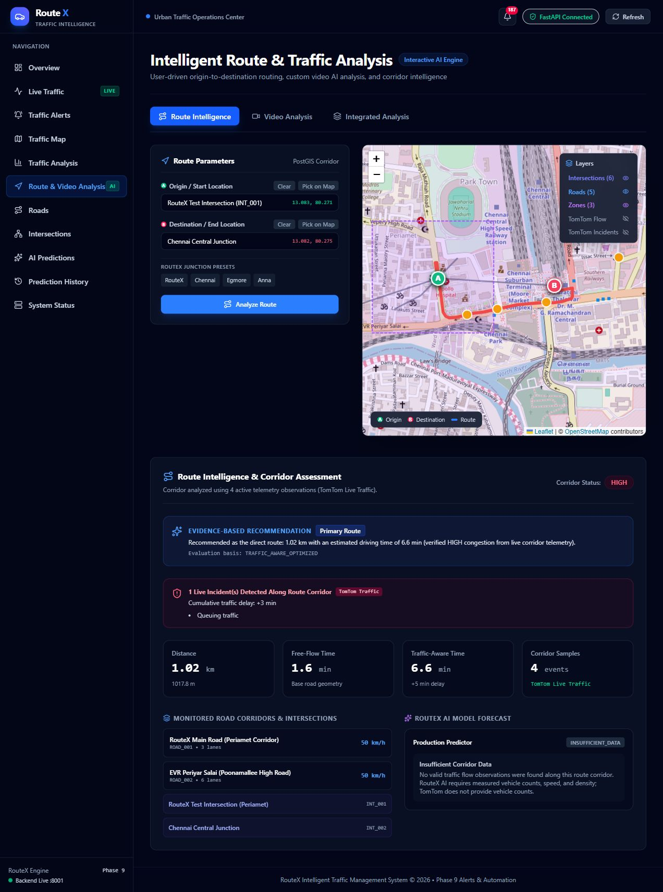
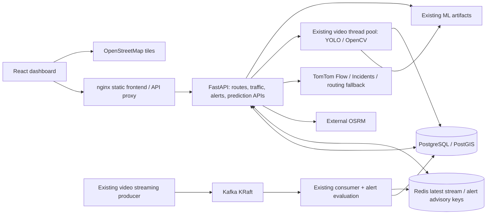

# RouteX — AI-Powered Traffic Monitoring & Route Intelligence Platform

[](https://github.com/roop2006/RouteX/actions/workflows/ci.yml)

A shared route view for live traffic, spatial analysis, vehicle detection, predictions, and persistent alerts.

## Overview and problem

Traffic information is often split across maps, camera tools, provider feeds and prediction dashboards. RouteX connects these sources around a selected journey. Its React dashboard shares route geometry across traffic analysis, registered roads, intersections, predictions and incident alerts. FastAPI combines PostGIS spatial matching with OSRM routing, TomTom traffic data, YOLO video analysis, an existing ML inference pipeline and Kafka event processing.

The current reference geography is a small Chennai demonstration inventory. RouteX reports unavailable inputs and provider failures explicitly; it does not guarantee safe travel or replace operational traffic-control systems.

## Features

- OpenStreetMap maps, origin/destination routing, alternatives and shared selected-route context.
- TomTom Flow and Incidents with bounded requests, caches and explicit unavailable/stale states.
- PostGIS route-corridor matching for observations, registered roads and intersections.
- Route-specific incident alerts and synchronized inspectable map markers.
- Uploaded-video analysis: YOLO11n detection, BoT-SORT tracking, counting, lanes, direction, density and calibrated speed estimates.
- Existing urban ML predictions, prediction history and evaluation; a separate interstate benchmark model.
- Kafka camera-event processing into PostgreSQL and Redis, with durable message identities.
- Persistent alert rules, acknowledgement/resolution, notification records and diagnostics.

Provider vehicle counts are unavailable, not inferred from TomTom speed. Routes without measured model inputs report insufficient prediction data.

## Screenshots

Captured from the production Docker frontend on 2026-11-18. The disposable verification database also contains clearly labelled test observations; these images are interface evidence, not traffic-performance benchmarks.



[Route alerts](docs/screenshots/route-alerts.jpg) · [Traffic map](docs/screenshots/traffic-map.jpg) · [System diagnostics](docs/screenshots/system-status.jpg)

## Architecture



Video workers, model inference and API alert evaluation run in the backend process. They are not extra microservices. The Kafka consumer is the independent long-running worker. TomTom provider caches are in-process; Redis serves stream snapshots and advisory alert deduplication.

## Technology stack

| Area | Technology |
|---|---|
| Frontend | React 19, TypeScript, Vite 8, Tailwind CSS, React Leaflet, TanStack Query, Recharts |
| API / spatial ORM | Python 3.12, FastAPI, SQLAlchemy, GeoAlchemy2, psycopg |
| Persistence | PostgreSQL 17 + PostGIS 3.5 in Docker; native PG18 remains supported separately |
| Streaming / cache | Apache Kafka 4.0 KRaft, kafka-python, Redis 7.4 |
| Vision | Ultralytics YOLO11n, BoT-SORT, OpenCV, CPU PyTorch, FFmpeg |
| ML | scikit-learn, pandas, NumPy, joblib; existing model artifacts |
| Routing / traffic | Configurable external OSRM, TomTom APIs, OpenStreetMap |
| Packaging / CI | Docker Compose, nginx unprivileged, GitHub Actions |

See [verified architecture and model provenance](docs/ARCHITECTURE.md).

## Project structure

```text
backend/app/       API endpoints, schemas, models, services, additive migrations
frontend/src/      Dashboard, shared selected route, maps and feature pages
vision/            Existing detection, tracking, traffic processing and streaming
ml/                Data utilities, features, model code, artifacts and evaluation
ml/artifacts/      Existing small models, metadata and compressed external model
deploy/            Initialization, asset verification, proxy and acceptance scripts
tests/             Backend, provider, geospatial and integration regressions
docs/              Architecture, Docker operations, security and verification reports
.github/workflows/ CI checks
docker-compose.yml Complete local stack
compose.dev.yml    Optional loopback ports for native development
compose.test.yml   Disposable integration-test runner
```

## Prerequisites

- Docker Engine with Compose v2 or Docker Desktop using Linux containers. No host Python, Node, PostgreSQL, Redis or Kafka is required for the Docker setup.
- Linux amd64-compatible CPU; GPU is not required. Allow at least 6 GB Docker memory and 12 GB free disk; 8 GB memory is preferable for video workloads.
- Internet access for initial images, packages and pinned YOLO weights, plus routing/maps/provider requests during operation.
- Your own TomTom API key for real live traffic. The rest of the system remains usable with explicit provider-unavailable states when no key is configured.

## Quick start

```sh
git clone https://github.com/roop2006/RouteX.git
cd RouteX
```

The repository is currently private; cloning requires access. Copy `.env.example` to `.env.docker` (`cp` on POSIX, `Copy-Item` in PowerShell). Set a unique URL-safe `POSTGRES_PASSWORD`, and optionally `TOMTOM_API_KEY`. Do not overwrite an existing native-development `.env`.

```sh
docker compose --env-file .env.docker config --quiet
docker compose --env-file .env.docker up -d --build
docker compose --env-file .env.docker ps -a
```

The first build downloads and verifies YOLO weights, expands the packaged existing interstate model, and installs CPU inference dependencies. No training is performed. One-shot services initialize PostGIS/schema/reference geography and Kafka volume permissions/topics before the backend and consumer start. Large videos and historical training datasets are not included; upload a video you have permission to process.

## Environment configuration

| Variable | Meaning / default |
|---|---|
| `POSTGRES_PASSWORD` | Required unique URL-safe local database password |
| `POSTGRES_USER`, `POSTGRES_DB` | `routex`, `routex_db` |
| `FRONTEND_PORT`, `BACKEND_PORT` | Loopback ports `5173`, `8001` |
| `TOMTOM_API_KEY` | Empty by default; never baked into images or frontend |
| `OSRM_BASE_URL` | `https://router.project-osrm.org`; external routing, no local map preprocessing |
| `CORS_ORIGINS` | Exact allowed browser origins, comma-separated |
| `KAFKA_TRAFFIC_TOPIC`, `KAFKA_GROUP_ID` | Existing stream topic and consumer group |
| `POSTGRES_PORT`, `REDIS_PORT`, `KAFKA_PORT` | Optional `compose.dev.yml` host ports: `5434`, `6379`, `9092` |

Obtain a key through the [TomTom Developer Portal](https://developer.tomtom.com/). Enable the [Flow Segment Data](https://docs.tomtom.com/traffic-api/documentation/tomtom-maps/v1/traffic-flow/flow-segment-data) and [Incident Details](https://docs.tomtom.com/traffic-api/documentation/tomtom-maps/v1/traffic-incidents/incident-details) products; routing fallback and map overlays need the corresponding products. Check your account's current quotas and usage terms. No paid plan is assumed or purchased.

## Access and usage

| Service | Local URL |
|---|---|
| Dashboard | http://localhost:5173 |
| API documentation | http://localhost:8001/docs |
| Readiness | http://localhost:8001/health/ready |
| Integration diagnostics | http://localhost:8001/health/integrations |

1. Open Route & Video Analysis, choose source/destination, and calculate a route. Alternatives update the shared selected geometry.
2. Visit Traffic Analysis, Roads and Intersections to inspect matched corridor data. Changing endpoints clears the old route-derived state.
3. Inspect Live Traffic and Alerts for provider availability, timestamps, severity and location. The map shows corresponding incident markers.
4. Upload a supported video under 100 MB for detection/tracking and result playback. Assign an intersection only when the recording's location is known.
5. Inspect Predictions and Prediction History. Missing measured counts are reported as insufficient data. The interstate benchmark is separate from urban route inference.
6. Use Alerts to acknowledge/resolve reports and configure existing rules. These are local administrative operations; the application does not yet authenticate users.

## Testing and verification

```sh
npm --prefix frontend ci
npm --prefix frontend run lint
npm --prefix frontend run build
npm --prefix frontend audit --audit-level=high
```

These are native frontend-development commands; Docker builds run the production build without requiring host Node. Backend tests must target a disposable database. The [Docker test procedure](docs/DOCKER.md#isolated-automated-tests) runs the existing suite in containers with real PostGIS and explicitly mocked external provider transports. It includes the real-provider and real-video acceptance commands. Never run fixture-writing integration tests against production records.

The full npm audit currently reports one unfixed development-only picomatch advisory (plus inherited toolchain findings). Production dependencies audit clean. CI uses `python deploy/audit_frontend.py` with a narrow, expiring exception; see the [security finding](docs/SECURITY_AND_CREDITS.md#known-development-only-advisory-2026-11-18).

CI validates frontend lint/build/dependencies, repository hygiene, Compose configuration, Docker builds, backend regressions, Python dependency advisories and production proxy routes. No frontend unit-test framework currently exists. Actual execution results and limitations are recorded in [the Phase 10 verification report](docs/PHASE10_REPORT.md); a workflow file alone is not evidence of a passed GitHub run.

## Operations and troubleshooting

Use `docker compose --env-file .env.docker stop` to pause services and `down` to remove containers while preserving named volumes. Do not use `down -v` on application data. See [Docker operation, initialization, backup/restore and troubleshooting](docs/DOCKER.md).

Common issues include a stopped Docker daemon, port conflicts, changing a database password after volume initialization, unavailable providers, missing model downloads, and undecodable videos. `/health` is process liveness; `/health/ready` verifies database schema access. Integration status reflects actual checks and can legitimately show an idle video worker or unverified provider.

## Decisions and limits

- Existing architecture and models are preserved; CPU inference and one Uvicorn worker support the current in-process video-job design.
- Data volumes persist; video job metadata and provider caches are in memory. Restarting the API interrupts active jobs and loses job lookup state.
- Kafka TCP reachability is distinct from verified consumer processing. A real disposable-stack streaming acceptance script is provided.
- Geographic references are simplified Chennai demonstration data. Route corridors can include nearby parallel roads; incident direction compatibility is unverified where OSRM has no matching TMC reference.
- External OSRM has no availability guarantee. A configurable endpoint supports an operator-managed service; self-hosted routing datasets are not part of this setup.
- TomTom-only telemetry cannot provide measured vehicle counts required by the urban model. No missing measurements are fabricated.
- Local-only defaults are intentional. Authentication, authorization, TLS, quotas, upload retention and durable job metadata are required before a public deployment. See [security and credits](docs/SECURITY_AND_CREDITS.md).

## Future improvements

Optional work includes durable video jobs, authenticated operator roles, larger verified geographic reference coverage, calibrated camera speed measurements and an operator-managed OSRM service. These are not represented as completed functionality.

## License and credits

No project-wide license has been assigned; the owner's approval is required for a new license decision. Third-party code, models and data retain their own licenses. Ultralytics YOLO11 is AGPL-3.0 (with an upstream enterprise option), OpenStreetMap requires attribution under ODbL, and the Metro Interstate Traffic Volume dataset is CC BY 4.0. See [sources and redistribution notes](docs/SECURITY_AND_CREDITS.md). Do not load untrusted serialized models.

## Project status

Phases 1–9 are preserved in checkpoint `1ea0387` (`Complete Phase 9 - Alerts and Traffic Reliability`). Phase 10 adds reproducible container packaging, initialization, CI and documentation. Consult [the verification report](docs/PHASE10_REPORT.md) for measured results, publication status and remaining limitations. [Phase 9 evidence](docs/PHASE9_INTEGRATION_REPORT.md) remains available as a historical record.
